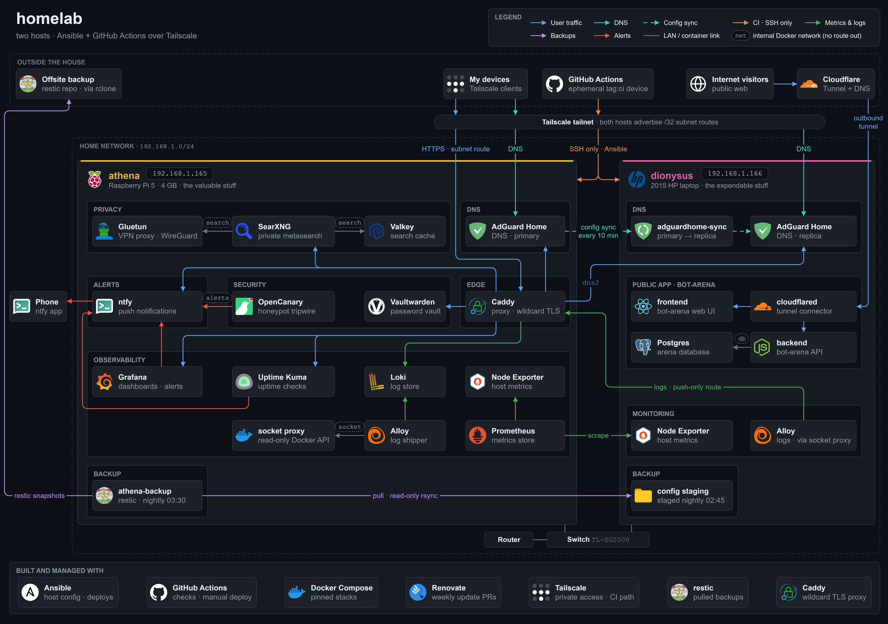

# homelab

Two small machines running my home infrastructure, with host configuration and container deployment managed through Ansible and GitHub Actions over Tailscale. Every service is a pinned Docker Compose stack and every managed host file lives in this repo. Secrets, Tailscale enrollment and some in-app settings are set up separately (see *Design decisions*).

> **This is a sanitized public mirror of my private homelab repo.** It's synced now and then; day-to-day work happens in the private repo. The domain is `example.com`, SSH keys, the tunnel ID and password hashes are placeholders, and one private app stack on dionysus is left out. Hostnames and LAN addresses (private `192.168.x` ranges) are real.

## Architecture

<p align="center">
  <a href="https://raw.githubusercontent.com/OzDomer/homelab/main/docs/architecture.drawio.png">
    
  </a>
  <br>
  <sub>Click to open full size.</sub>
</p>

| Host | Hardware | Runs |
|---|---|---|
| **athena** | Raspberry Pi 5, 4 GB | Caddy, Vaultwarden, Uptime Kuma, AdGuard Home (primary), SearXNG, Prometheus + Grafana + Loki, ntfy, OpenCanary, nightly backups of **both** hosts, a kiosk status screen on the TV |
| **dionysus** | 2015 HP laptop, i3, 4 GB | AdGuard Home (replica), [bot-arena](https://arena.domer.dev) (Cloudflare Tunnel), metrics + log shipping |

The split is on purpose: everything I can't afford to lose lives on athena, and dionysus is treated as disposable. It holds no backup credentials: no restic password and no cloud storage token.

## Design decisions

**Config in git, secrets in the vault, state in backups.** Compose files, Caddyfile, system files and Ansible roles live here. Secrets live in `.env` files on the hosts (never in git), with copies in Vaultwarden and in the encrypted backups. App state (databases) is backed up nightly. A rebuild is "flash the OS, restore secrets, run the playbook". **Decided next step:** move the `.env` files into the repo encrypted with **SOPS + age**, so secrets are versioned next to the config they belong to and a rebuild needs one key instead of a restore.

**CI can reach SSH and nothing else.** Deploys are a manual GitHub Actions workflow (dry run by default). The runner joins the tailnet as an **ephemeral `tag:ci` device** through an OAuth client that can only mint that one tag. The Tailscale policy allows `tag:ci` → `tcp:22` on the two hosts only, and the policy's own tests reject edits that would open selected web, DNS and app ports to it. On top of that, every run does a regression check backing up the policy: it confirms SSH answers and **fails if any of a few forbidden endpoints** (HTTPS and DNS on athena, an app port on dionysus) **answer too**, before the SSH key and sudo password are written to the runner. The CI key in `authorized_keys` is restricted to Tailscale addresses (`from="100.64.0.0/10"`) with all forwarding disabled. The job token is read-only, and the runner always logs out of the tailnet at the end.

**Backups are pulled, never pushed.** One restic script on athena takes a separate snapshot per app (Vaultwarden, Kuma, AdGuard, Grafana, secrets, dionysus), so one broken app never blocks the rest and each can be restored on its own. SQLite databases are copied with `.backup`, then verified with `integrity_check` plus a minimum-row check (an empty, freshly recreated database passes `integrity_check`). For dionysus, athena logs into a dedicated `backup-pull` account whose key is pinned to athena's address and forced into `rrsync -ro` on one staging folder: athena can read that folder and do nothing else. dionysus writes a freshness stamp only after a fully verified staging run, and athena refuses anything older than 25 h, so a dead timer shows up as a failed backup instead of silently stale data. Every run reports to an Uptime Kuma push monitor.

**Network isolation with internal Docker networks.** Apps that face untrusted input are kept away from the rest:
- SearXNG parses content from the open web, so it sits on an `--internal` network with only Caddy, Uptime Kuma, its cache and a dedicated VPN proxy. Its engine requests leave through their own WireGuard tunnel and never touch the home IP, and it has no direct network path to Vaultwarden or the other apps.
- OpenCanary exists to receive hostile traffic, so it stays off the shared `proxy` network the other apps sit on. It sends alerts over an internal network shared only with ntfy; its default bridge publishes the fake ports on the LAN and keeps normal outbound access.
- Alloy never mounts the Docker socket. A socket proxy holds it and allows only read-only list/inspect/logs calls.
- bot-arena's database is on an internal network that only the backend can reach. The tunnel connector talks to the frontend and the API only.

**Docker ports are always bound to a specific address** (the host's LAN address or `127.0.0.1`, never bare), because published ports bypass ufw. ufw is deny-by-default and managed by Ansible behind its own `firewall` tag, so a routine deploy can never touch it.

**Real client IPs over Tailscale.** Both hosts advertise `/32` subnet routes with `--snat-subnet-routes=false`. Tailscale devices reach the services through Tailscale even at home, and Caddy and AdGuard see each device's real `100.x` address instead of a Docker gateway. That's also what makes the `from=` restriction on the CI key possible.

**DNS that survives a dead host.** Two AdGuard Home instances, handed out together by Tailscale. Settings are changed on the primary only and synced to the replica every 10 minutes. Either can go down without breaking DNS or ad blocking (tested by stopping the primary). Internal names exist only in AdGuard. The only public DNS records are bot-arena's two tunnel hostnames.

**Pinned everything, updated by PR.** Every image tag, the Caddy build and its DNS plugin are pinned in git. bot-arena images are pinned by digest. Renovate opens grouped PRs weekly and nothing automerges, so a host only changes when the repo does.

## Observability and alerting

- **Metrics:** Prometheus scrapes Node Exporter on both hosts. Exporters listen only where Prometheus can reach them (a Docker bridge gateway on athena, a single ufw-allowed port on dionysus).
- **Logs:** Alloy ships container logs and the systemd journal from both hosts to Loki. dionysus pushes through a Caddy route that exposes only Loki's push endpoint, behind basic auth.
- **Dashboards and alerts:** Grafana alerts on dead scrape targets and filling disks. Uptime Kuma checks the services (and the public tunnel path end to end).
- **Notifications:** everything goes to a self-hosted ntfy server with `deny-all` by default. Each sender (Kuma, Grafana, OpenCanary) has its own user with write-only access to one topic.
- **Tripwire:** OpenCanary runs fake FTP, Telnet, MySQL, RDP and VNC on athena's LAN address. Any connection attempt sends a push to my phone.

## Repo layout

```
site.yaml, inventory.yaml   playbook entry point and the two hosts
host_vars/                  per-host stack lists and firewall rules
roles/
  common/                   both hosts: sshd hardening, authorized_keys, Docker
  firewall/                 ufw (only runs with --tags firewall)
  stacks/                   copies each stack and runs docker compose up
  athena/  dionysus/        host-specific system files, backups, kiosk
athena/  dionysus/          one folder per Compose stack
.github/workflows/          checks on every push, manual deploy
renovate.json               grouped, pinned image updates
```

Every push runs `ansible-lint`, a playbook syntax check, `shellcheck` on the scripts, `docker compose config` on every stack, and a JSON check, all with no secrets and a read-only token.

## Next

- **SOPS + age** for secrets in git (decided, see above)
- An **external watcher for athena**: all alerting runs on athena, so if athena itself dies, nothing alerts
- Move Grafana dashboards and alert rules into **provisioning files** in git
